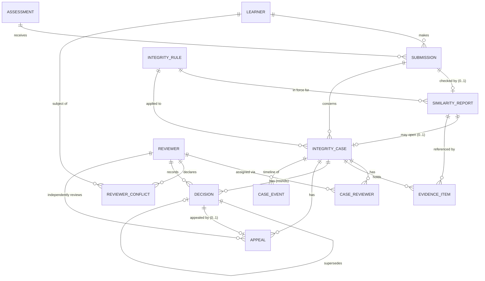

# Entity relationship diagram

The 10 required entities, plus three supporting tables: `reviewer_conflict` (declared conflicts),
`case_reviewer` (the Case N:M Reviewer bridge, with assignment history) and `case_event` (the audit
timeline).



## Cardinality notes

| Relationship | Cardinality | Notes |
|---|---|---|
| Learner – Submission | 1 : N | One submission per learner per assessment (`UNIQUE(learner_id, assessment_id)`). |
| Assessment – Submission | 1 : N | |
| Submission – SimilarityReport | 1 : 0..1 | Enforced by `UNIQUE(submission_id)` (assumption A1). |
| IntegrityRule – SimilarityReport | 1 : N | The rule whose effective window contains `generated_at`. |
| SimilarityReport – Case | 1 : 0..1 | Only flagged reports can open a case; `UNIQUE(similarity_report_id)`. |
| Case – Reviewer | N : M | Through `case_reviewer` (role primary / secondary / appeal; status active / completed / blocked_conflict). |
| Case – EvidenceItem | 1 : N | Append-only, `case_evidence_seq` 1..n. |
| Case – Decision | 1 : N | Round 1 = first decision; a successful appeal adds a round that supersedes the earlier one. |
| Decision – Appeal | 1 : 0..1 | `UNIQUE(decision_id)`: one appeal per decision. Case – Appeal is 1 : N across rounds. |
| Case – CaseEvent | 1 : N | Every state change; `event_seq` 1..n per case. |

Optional relationships: `decision.reviewer_id` is nullable only so the *automatic guilt* negative
scenario can be represented and then detected; the workflow never writes a NULL there.
`appeal.appeal_reviewer_id` stays NULL until an independent reviewer is assigned.

## Lifecycle

```
open --reviewer_assigned--> under_review --decision_recorded--> decided --case_closed--> closed
                                                                   |  ^
                                                    appeal_submitted  appeal_decided
                                                                   v  |
                                                                appeal_open
```
